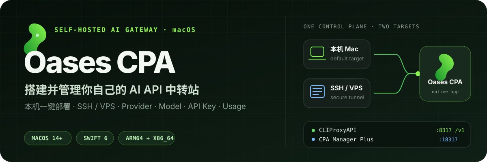
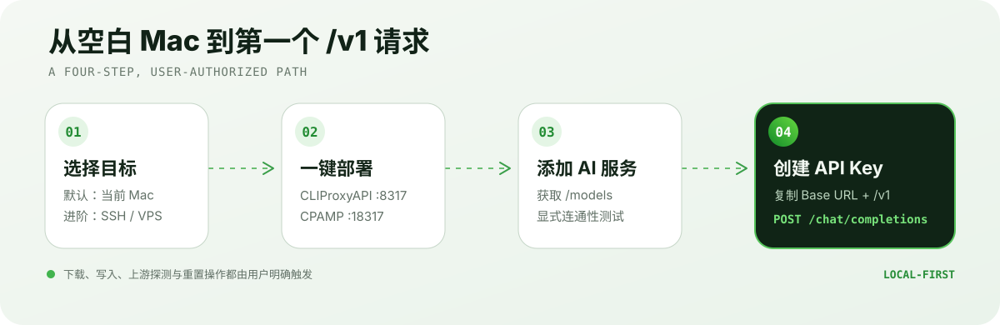

<p align="center">
  
</p>

<p align="center">
  <a href="#快速开始">快速开始</a> ·
  <a href="#从部署到第一次调用">使用路径</a> ·
  <a href="#安全边界">安全边界</a> ·
  <a href="#开发与构建">开发构建</a> ·
  <a href="#english-overview">English</a>
</p>

Oases CPA 是一个原生 macOS 控制台，用来部署、连接并管理用户自己的
[CLIProxyAPI](https://github.com/router-for-me/CLIProxyAPI) 与
[CPA Manager Plus](https://github.com/seakee/CPA-Manager-Plus)。默认可直接部署到当前 Mac，也可以通过 SSH 管理 Linux/macOS VPS；日常的 Provider、模型、API Key、用量、成本和运行状态都在一个 App 内完成。

> 当前版本为 `0.1.3` 预发布版本，最低支持 macOS 14。发行构建同时支持 Apple Silicon 与 Intel Mac。

## 它解决什么问题

CLIProxyAPI 能把多个 AI Provider 汇聚为统一的 OpenAI 兼容接口，但对初次接触终端、配置文件、SSH 隧道和服务进程的用户并不轻松。Oases CPA 把这条链路整理成可见、可恢复的 macOS 工作流：

| 目标 | Oases CPA 提供的体验 |
| --- | --- |
| 快速开始 | 本机优先的一键部署；环境检测、下载、校验、配置和启动归入一条进度流程 |
| 管理远程机器 | 保存多个本机或 SSH/VPS 目标，通过本机回环隧道访问管理 API 和 CPAMP 面板 |
| 接入 AI 服务 | 原生管理 OpenAI-compatible、Gemini、Claude、Codex、xAI、Vertex 等凭证与路由配置 |
| 找到可用模型 | 显式请求上游 `/models`，展示模型 ID，并提供不会自动改写配置的连通性检查 |
| 交付调用凭据 | 创建、轮换、删除调用 API Key，直接给出带 `/v1` 的 Base URL |
| 观察真实运行 | 实时仪表盘、六维用量分析、请求事件、配额、账号待办、日志与凭证健康巡检 |
| 估算模型成本 | 从 models.dev、LiteLLM 与 OpenRouter 公开元数据同步价格，并结合真实用量估算成本 |

## 从部署到第一次调用

<p align="center">
  
</p>

完成部署后，在 AI IDE 或 SDK 中填写：

```text
Base URL   http://127.0.0.1:8317/v1
API Key    在「调用 API Key」页面创建
API 格式   OpenAI Compatible / Chat Completions
Model ID   从仪表盘或 Provider 的 /models 结果中选择
```

远程目标也默认通过 SSH 映射到本机回环地址，因此不需要把管理端口 `8317` / `18317` 直接暴露到公网。外部发布 API 时，仍应由用户自行配置 TLS、反向代理和防火墙。

## 快速开始

### 安装发行版

已签名的安装包将在 [GitHub Releases](https://github.com/qingtengCHINA/OasesCPA-Desktop/releases) 提供。打开 `OasesCPA.dmg` 后，将 Oases CPA 拖入 Applications 即可。

如果 Releases 中暂时没有适合当前版本的安装包，请从源码运行。

### 从源码运行

要求：macOS 14 或更新版本，以及带 Swift 6 的 Xcode 工具链。

```bash
git clone https://github.com/qingtengCHINA/OasesCPA-Desktop.git
cd OasesCPA-Desktop
./script/build_and_run.sh
```

验证构建并确认进程成功启动：

```bash
./script/build_and_run.sh --verify
```

首次打开时，欢迎引导会说明 CPA、CLIProxyAPI 和完整调用路径。进入 App 后：

1. 打开「连接与部署」，保持默认的“本机 Mac”，然后点击部署。
2. 部署完成后，在「AI 提供商」添加自己的 AI 服务，可按需获取 `/models` 并测试连通性。
3. 在「调用 API Key」创建调用密钥。
4. 将 App 给出的 `/v1` Base URL、API Key 和 Model ID 填入支持 OpenAI 格式的 AI IDE 或 SDK。

## 原生管理能力

### 连接与生命周期

- 本机原生二进制部署，以及面向进阶用户的 Docker Compose 模式。
- 通过 SSH 连接 Linux/macOS VPS，独立保存多个目标和主机指纹。
- 部署失败日志、可恢复清理、升级、备份和上一版本回滚。
- 每 30 秒检查服务与 SSH 隧道；异常时按用户保存的运行意图恢复。
- 关闭主窗口后继续在菜单栏运行；真正退出 App 时会回收 SSH 隧道和占用端口的子进程。

### Provider、模型与认证

- 原生管理 OpenAI-compatible Provider 及内置 Provider 凭证池。
- API Key 权重、优先级、冷却策略、独立代理、Headers、模型别名/映射、输入/输出模态与未知高级字段保真。
- Codex、Anthropic、Antigravity、Kimi、xAI 与 OpenRouter PKCE OAuth。
- 认证文件可按 Provider、状态和搜索词筛选，支持排序、紧凑显示、模型清单、额度证据、字段编辑、批量启停与批量删除。
- Provider 编辑窗口与配置页均提供未保存变更保护。

### 原生 CPAMP 工作台

这部分直接按 CPA Manager Plus 与 CLIProxyAPI 的当前管理 API 契约实现，不依赖网页套壳：

| 工作台 | 原生能力 |
| --- | --- |
| 用量分析 | 总览、趋势、模型、客户端 Key、凭证和热力图六个视角；支持时间范围、粒度、模型、Key、Provider、状态与缓存筛选 |
| 认证文件 | Provider 分组、搜索、排序、异常过滤、模型目录、额度信息、优先级/备注等字段编辑和批量操作 |
| 配置面板 | 面向新手的可视化快捷配置、完整 YAML 源文件编辑和 CPAMP 设置三种模式；失败字段可直接重试 |
| 系统信息 | CLIProxyAPI、CPA Manager Plus 与使用指南快捷入口，以及从当前网关 `/v1/models` 实时读取并按 Provider/模型族分组的模型目录 |

高级网页面板仍保留为兼容入口，但常用管理流程不再要求用户在原生 App 与 WebUI 之间来回切换。

### 监控、配额与成本

- 仪表盘每 5 秒读取当前目标状态，无需手动刷新。
- 六维用量分析与高级筛选、真实请求事件流、认证历史和脱敏错误证据。
- Codex、Claude、Kimi 与 xAI 配额窗口、冷却状态和显式重置。
- 公开模型价格自动同步、手动价格覆盖和本地成本估算。
- CPAMP 面板仍作为高级诊断和兼容性入口；SPA 子页面不会被周期刷新打回首页。

### macOS 体验

- SwiftUI 原生界面，支持中文、英文、浅色、深色和跟随系统。
- 首次使用欢迎引导、可滚动且可缩放的独立编辑窗口、菜单栏运行状态。
- 部署过程支持安全暂停、继续和取消；取消时可选择保留现场，或彻底移除受管部署目录、服务与凭据。
- 启动后定期检查官方 GitHub Release Tag；发现新版本时在标题栏提示，并可直接下载、打开最新 DMG。
- 设置页底部实时读取 App Bundle，显示实际版本号与构建号。
- 完整 AppIcon、Xcode 工程、Privacy Manifest、Developer ID/App Store 两套 Entitlements。

## 安全边界

Oases CPA 会执行下载、安装、进程管理和远程 SSH 操作，因此所有有副作用的步骤都需要明确的用户动作。

- CPA/CPAMP 管理密钥与每个目标的 SSH 私钥存放在 macOS Keychain。
- 启动 App 或切换目标不会自动读取钥匙串；只有用户点击连接后才会访问凭据。
- SSH 使用 App 专属 `known_hosts`、`StrictHostKeyChecking=accept-new` 与 `BatchMode`，不会修改用户全局 SSH 主机记录。
- Provider 连通性检查需要确认，只读取安全摘要，不展示密钥、请求头、响应正文或原始元数据。
- 远程管理 API 和面板默认通过 SSH 隧道绑定本机回环地址。
- 停止生命周期操作前会确认 PID 对应进程确实属于 Oases CPA 安装目录。

## 开发与构建

项目同时提供 Swift Package 和可上架维护的 Xcode 工程：

```bash
swift test
xcodegen generate
open "OasesCPA.xcodeproj"
```

`OasesCPA.xcodeproj` 由 `project.yml` 生成，包含 Debug、Release 与 AppStore 配置。请在 Xcode 的 Signing & Capabilities 中选择自己的 Apple Developer Team；不要把 Team ID、证书或 App Store Connect 凭据提交到仓库。

### 生成 DMG

每次准备新版本时，先自动递增 patch 版本号与 build 号，并同步重新生成 Xcode 工程：

```bash
./script/bump_patch_version.sh
```

例如 `0.1.2 (38)` 会变为 `0.1.3 (39)`。然后生成发行包：

```bash
./script/package_release.sh
```

默认使用 ad hoc 签名，只适合本机测试。Developer ID 分发示例：

```bash
CODESIGN_IDENTITY="Developer ID Application: Your Company (TEAMID)" \
APP_VERSION="0.1.3" APP_BUILD="39" \
./script/package_release.sh
```

如已配置 `notarytool` 钥匙串凭据，可让脚本完成公证、stapling 和重新校验：

```bash
CODESIGN_IDENTITY="Developer ID Application: Your Company (TEAMID)" \
NOTARIZE=1 NOTARY_PROFILE="oases-cpa-notary" \
./script/package_release.sh
```

产物位于 `dist/release/<version>-<build>/`。DMG 包含 App、Applications 快捷方式、背景图和 Finder 拖拽布局。

<details>
<summary><strong>显式运行真实部署集成测试</strong></summary>

这些测试会下载上游包或启动临时服务，默认不会执行：

```bash
OASES_CPA_RUN_INTEGRATION=1 swift test \
  --filter RuntimeDecodingTests/testNativeDeploymentEndToEndWhenExplicitlyEnabled

OASES_CPA_RUN_SSH_INTEGRATION=1 swift test \
  --filter RuntimeDecodingTests/testSSHNativeDeploymentEndToEndWhenExplicitlyEnabled

OASES_CPA_RUN_DOCKER_INTEGRATION=1 swift test \
  --filter RuntimeDecodingTests/testDockerDeploymentEndToEndWhenExplicitlyEnabled
```

真实测试会占用临时端口或容器，并在结束后执行清理。

</details>

## App Store 状态

当前完整版会下载、安装并执行 CLIProxyAPI 与 CPA Manager Plus，因此不能把现有构建描述为已经满足 Mac App Store 审核要求。仓库保留了 AppStore 配置，但正式提交前应先阅读 [APP_STORE_READINESS.md](./APP_STORE_READINESS.md)，并按文档拆分不包含本机组件部署的商店版本。

直接从 GitHub Releases 下载 DMG 的更新机制同样属于 Developer ID / GitHub 直接分发流程；未来的 Mac App Store 变体应关闭该机制，并只通过 Mac App Store 更新。

完整版更适合通过 Developer ID 签名、公证和 GitHub Releases 直接分发。

## 项目结构

```text
Sources/OasesCPA/
├── App/          App 生命周期、窗口、命令与菜单栏
├── Views/        部署、仪表盘、Provider、配置与诊断界面
├── Stores/       App 状态、实时数据和部署状态机
├── Services/     SSH、部署、Keychain、生命周期与管理 API
├── Models/       CLIProxyAPI / CPAMP 请求响应模型
├── Components/   原生视觉组件
└── Resources/    图标、本地化、隐私清单与开源许可证

Tests/OasesCPATests/   状态机、API 契约、安全边界与部署测试
script/                本地运行与发行打包脚本
```

## 开源引用与隐私

Oases CPA 独立开发，不隶属于以下上游项目：

- [router-for-me/CLIProxyAPI](https://github.com/router-for-me/CLIProxyAPI) — MIT License
- [seakee/CPA-Manager-Plus](https://github.com/seakee/CPA-Manager-Plus) — MIT License

完整版权和许可证文本见 [THIRD_PARTY_NOTICES.md](./THIRD_PARTY_NOTICES.md)，App 内也可从“设置 → 关于 → 开源许可与致谢”查看。

- [隐私声明](https://www.freeprivacypolicy.com/live/e016e69e-1613-454a-83cb-411674f7d303)
- [作者 · QingTeng Studio](https://qingtengstudio.com/)
- [CLIProxyAPI 文档](https://help.router-for.me/)

## English overview

Oases CPA is a native macOS control plane for deploying and managing your own CLIProxyAPI and CPA Manager Plus stack. It supports local deployment and SSH-connected Linux/macOS servers, then brings providers, model discovery, API keys, usage, costs, quotas, logs, and service health into one SwiftUI app.

The shortest path is: **deploy locally → add a provider → fetch `/models` → create an API key → call the `/v1` endpoint**. Remote targets stay accessible through localhost SSH tunnels by default, and management credentials are stored in macOS Keychain only after an explicit connection action.

```bash
git clone https://github.com/qingtengCHINA/OasesCPA-Desktop.git
cd OasesCPA-Desktop
./script/build_and_run.sh
```

Requires macOS 14+ and a Swift 6 Xcode toolchain. See [App Store readiness](./APP_STORE_READINESS.md) and [third-party notices](./THIRD_PARTY_NOTICES.md) before distribution.
